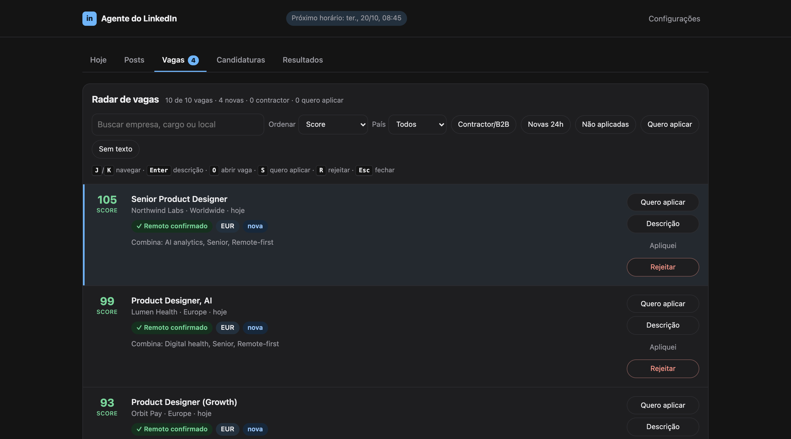

# Job Hunt Agent

A personal agent that hunts design jobs, ranks them against hard rules, and helps with LinkedIn outreach, with a human approving every outgoing message.

Built for my own search as a remote Product Designer. It runs hourly, reads public job sources, and never applies or messages anyone on its own.



*The job radar, shown with fictional sample jobs. Each card has a score, a remote-confirmed check, and four actions; nothing is sent without a click. (The panel UI is in Portuguese.)*

## What it does

```
 public job sources ──► monitor/ (Node) ──► filters + rank ──► 14-day pool (engage-jobs.json)
 RemoteOK, Remotive,     collect, dedupe,    hard rules in        │
 Himalayas, Dribbble,    fetch full text     job-criteria.json    ▼
 WWR, Greenhouse/Lever/                                      agent/ (Python, local web panel)
 Ashby, LinkedIn (public)                                    review jobs, reject with a reason,
                                                             draft posts/comments via Claude CLI,
                                                             approve each one before it goes out
```

- **Hard rules as data.** Seniority, remote policy, countries, language, currency and contract type live in `monitor/job-criteria.json`. A JS engine (`filters.js`) and a Python mirror (`criteria.py`) apply them, and `test-criteria.js` proves both give identical results on frozen real-world cases.
- **Learns from rejections.** Each job you reject in the panel records a reason. Repeated patterns become *suggested* rules; nothing is added without approval.
- **Human in the loop.** The agent drafts; you approve, edit or reject. No auto-apply, no auto-send.
- **No account scraping.** LinkedIn jobs come from public pages only, with pauses and a block detector.

## Case study

**Problem.** A remote job search is a filtering job. Hundreds of postings a week, most of them wrong in ways the title hides: hybrid in the fine print, relocation required, a country restriction, pay in the wrong currency. Doing it by hand burns the time that should go into good applications.

**Constraint I set.** The agent may read, rank and draft. It may never apply or message anyone. Anything that speaks in my name needs my click.

**Decisions**

| Decision | Why |
|---|---|
| Rules live in `job-criteria.json`, not in code | I could change "no hybrid, no relocation" in one place and see the effect at once. Changing a preference should not mean changing logic. |
| Two engines (JS and Python) read the same file | The collector and the panel must never disagree about a job. A parity test runs frozen real postings through both and fails on any difference. |
| Every rejection records a reason | A rejected job is the best signal of what the rules miss. Repeated reasons become *suggested* rules that I approve or ignore. |
| "Confirm" labels instead of silent drops | When the text is ambiguous (for example "remote friendly"), the job stays visible with a label. A wrong exclusion is worse than one extra card to read. |
| Public pages only for LinkedIn | No account session, so no risk to the account. Pauses between requests, and a block detector that stops the run. |

**Result.** An hourly run that turns a noisy feed into a short ranked list, with the reason each job matched. I spend the time on the ten jobs worth reading, and every message that leaves is one I approved.

**What I would do next.** Show *why* a job was excluded in the panel (the data is already there), and let the user edit rules from the UI instead of the JSON.

## Layout

| Path | Role |
|---|---|
| `monitor/` | Collector, ATS fetchers, filters, ranking, notifications |
| `agent/` | Local panel (`localhost:8765`), drafting, engagement queue, application tracker |
| `agent/prompts/` | Templates for your profile, strategy and style (fill them in) |

## Run

Requires Node 18+ and Python **3.12+** (the code uses f-string syntax that 3.9 rejects). Drafting uses the [Claude Code CLI](https://docs.claude.com/en/docs/claude-code) (`claude -p`), already logged in.

```bash
cp .env.example monitor/.env
cd monitor && npm install
npm test                 # JS/Python rule parity
node job-monitor.js      # one collection run
cd ../agent && python3 agent.py   # panel on http://localhost:8765
```

Edit `agent/prompts/*.md` and `agent/config.json` first. `monitor/job-criteria.json` is a generic starter (remote-only, English, EUR/USD/GBP, no relocation). Stricter rules such as seniority, country and Spain-local hiring are defined but off: add their key to `order` to enable. `monitor/test-fixtures/reference-criteria.json` is a fully enabled example that the test suite uses.

## Status

Personal tool, published as a case study. Comments are in Portuguese and English. Scheduling (launchd) is not included.

MIT license.
